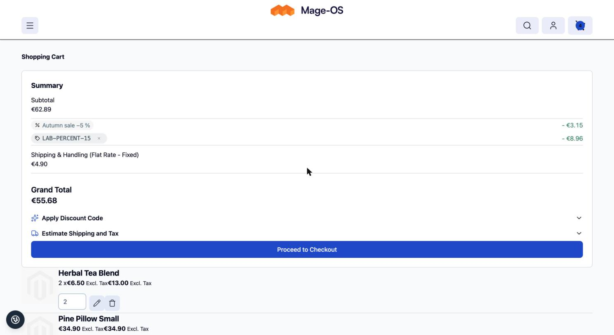
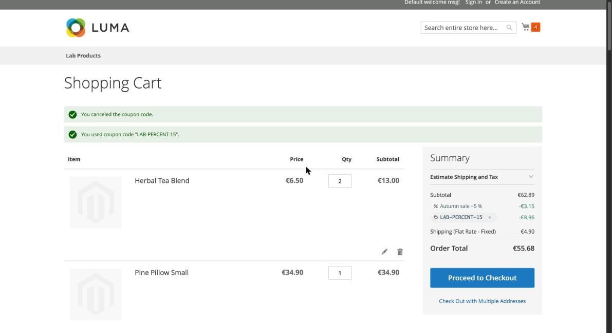

# Discount Lines for Magento 2

Magento merges every applied discount into one totals row, "Discount (...)", whose label is built from rule labels or,
worse, from internal rule descriptions. This module shows **one totals line per sales rule** instead, on every surface
where totals appear, and never shows a rule description or internal rule name to the customer.

- One line per rule in cart, checkout, order confirmation email, invoice email and PDF, credit memo email and PDF,
  My Account order view and admin order view.
- Per-rule amounts are stored when the order is placed (core keeps only `coupon_code`, `discount_description` and
  `applied_rule_ids`).
- The lines always add up to Magento's discount total, to the cent.
- Frontend-agnostic: this base package holds the data, storage, label rule, resolvers and the plain-text totals rows
  for all sales documents. The storefront renderers are separate packages (see below).

## Packages

| Package | Role |
|---|---|
| `pixelperfectat/magento2-module-discount-lines` | This package: data, storage, label rule, sales documents, configuration |
| `pixelperfectat/magento2-module-discount-lines-hyva-checkout` | Hyvä Checkout price summary |
| `pixelperfectat/magento2-module-discount-lines-hyva-theme` | Hyvä default theme cart page |
| `pixelperfectat/magento2-module-discount-lines-luma` | Luma cart summary and checkout sidebar |
| `pixelperfectat/magento2-module-discount-lines-amasty-promo` | Amasty Free Gift rules as gift lines |
| `pixelperfectat/magento2-module-discount-lines-mageplaza-giftcard` | Mageplaza gift cards as masked gift card lines |

## Requirements

- PHP 8.3+
- Magento 2.4.7+ or Mage-OS (`magento/module-sales-rule`, `module-quote`, `module-sales`)

## Installation

```bash
composer require pixelperfectat/magento2-module-discount-lines
bin/magento setup:upgrade
```

Add the renderer package for your frontend (Luma, Hyvä theme, Hyvä Checkout) and, if you use them, the Amasty or
Mageplaza adapter.

## Configuration

Stores > Configuration > Sales > Discount Lines. All settings have store-view scope.

| Path | Default | Description |
|---|---|---|
| `pp_discount_lines/general/enabled` | `1` | Master switch. When off, every surface shows the core `discount` row. |
| `pp_discount_lines/display/variant` | `B` | Storefront variant `A`, `B`, `C` or `D` (cart, drawer data, checkout). |
| `pp_discount_lines/documents/email_icon` | `0` | Flag for a small icon next to discount lines in emails (see note below). |

`documents/email_icon` is read through `ConfigInterface::isEmailIconEnabled()` and the icon files ship in
`view/frontend/web/images/` (`coupon.png`, `promotion.png`); the plain-text rows of this package do not render icons
themselves, a sales-email module that follows the contract below does.

### Display variants

Sales documents (email, PDF, My Account, admin) always use plain text, for example "Coupon CODE -2.25". The variants
apply to the storefront renderers:

| Variant | Look |
|---|---|
| A | Label with the coupon chip below |
| B | Chip as the label (default) |
| C | Grouped block with a "You save" sum |
| D | Quiet icon and monospace |

## Label rule

| Kind | Label | Amount column |
|---|---|---|
| `coupon` | the coupon code | -amount |
| `automatic` | the rule's store label for the order's store view, else the default store label, else a translated "Discount" | -amount |
| `free_shipping` | coupon: the code; automatic: store label or translated "Free shipping" | -shipping discount, or "Free" |
| `gift` | adapter: the coupon code | "Gift" when the gift carries no money, otherwise the amount |
| `gift_card` | adapter: "Gift card ••••1234" (masked, last 4) | -amount |

The rule description and the rule name are never used. Labels are snapshotted when the order is placed, so a rule that
is deleted or relabelled later does not change existing orders.

## How it works

- **Quote address storage at collect time.** After the totals of an address are collected, the per-rule lines are
  resolved and stored on the quote address (`quote_address.pp_discount_lines`). Resolution is one generic rule
  resolver (`RuleDiscountResolver`, reads core's per-rule discount breakdown of the address, so it covers every
  `simple_action` including `by_percent`, `by_fixed`, `cart_fixed` and `buy_x_get_y`) plus a free shipping resolver,
  both in a composite (`CompositeResolver`) that is the extension point: adapters add their own named resolvers to it
  through `di.xml`. The invariant is that the lines sum to the address discount; rounding differences of up to one
  cent per line are absorbed by the largest line, a larger unattributed remainder becomes a generic "Discount" line
  instead of being misattributed to a rule, and lines above the discount (or disagreeing between order and base
  currency) are dropped so the core row is shown with the plain title "Discount". A failed collect clears the stored
  lines.
- **Totals segment extension attribute.** A plugin on `CartTotalRepositoryInterface` adds the lines to the `discount`
  total segment as `extension_attributes.discount_lines` and replaces the segment title (which carries the rule
  description in core). When a quote has only zero-value lines (a gift or free shipping), a zero `discount` segment is
  added so renderers still get the lines. Stored lines that do not add up to the segment value are not exposed (the
  title is the plain "Discount"). The cart page and checkout renderers read this attribute.
- **Persistence at order placement.** On `sales_model_service_quote_submit_success` the lines are written to the table
  `pp_discount_line`: order-level lines plus item-level per-rule amounts (these make the credit memo split possible).
  When a discounted order has no attributable lines, one generic `automatic` "Discount" line for the full amount is
  stored, so the order never falls back to the core label.
- **Totals-block plugin.** A plugin on `Magento\Sales\Block\Order\Totals` (order, invoice and credit memo blocks, so
  emails, My Account and the admin) replaces the core `discount` row by one row per line. An invoice scales the stored
  lines to the invoice discount; a credit memo splits each rule in proportion to the refunded quantities and the
  largest line absorbs the rounding remainder, so the lines always equal the document's discount total. Stored order
  lines that do not add up to the order discount are scaled to it. When a document gets no line although the order
  has lines (for example a shipping-only refund), the core row keeps its amount and gets the plain label "Discount".
- **PDF total.** A PDF total model for `discount` (`etc/pdf.xml`) prints one line per rule in invoice and credit memo
  PDFs; zero-amount gift and free shipping lines print "Gift" / "Free" in the amount column.

Orders without stored lines (placed before the module was installed, or while it was disabled) are never touched and
keep the merged core row.

## Contract with the sales-email module

Each discount line is its **own totals row** in the standard Magento totals blocks
(`Magento\Sales\Block\Order\Totals` and descendants, invoice/creditmemo totals, PDF totals):

- totals row code: `pp_discount_line_<n>` (n = 0-based position), replacing the core `discount` row.
- the row (`\Magento\Framework\DataObject`) carries the data key **`discount_line`**:

```
discount_line = {
  kind:        "coupon" | "automatic" | "gift" | "free_shipping" | "gift_card",
  rule_id:     int|null,      // null for gift_card
  code:        string|null,   // coupon / gift-card code (masked for gift_card)
  label:       string,        // already resolved by the label rule, safe to show
  amount:      float,         // order currency, positive number = discount
  base_amount: float
}
```
- Row `label` and `value` stay populated (value negative, as core), so any template that ignores
  `discount_line` still prints a correct plain row → works without the email module.
- Without this module the email module renders the core `discount` row.
- Neither module requires the other in `composer.json` (at most `suggest`).
- Builder's call: expose the same array on the cart totals extension attributes
  (`TotalSegmentExtensionInterface`) for the storefront renderers.

Notes for consumers:

- Detect a discount line by the **`discount_line` data key** on any totals row, not by the row code: the row codes
  of this package are `pp_discount_line_<n>`, while gift card rows of the Mageplaza adapter keep Mageplaza's own codes
  (`gift_card` / `gift_card_<n>`) and carry `discount_line` with kind `gift_card`.
- A row without `discount_line` is a core row; the `discount` row of an order with stored lines carries the plain label
  "Discount", never the rule description.
- `DocumentLineLabelInterface` gives the plain label (`format()`), the signed value (`value()`) and the text printed in
  place of a zero amount (`amountText()`: "Gift" / "Free").

## Extending

- Add a line kind or handle a custom `simple_action` by adding a named `DiscountLineResolverInterface` to the
  `resolvers` argument of `CompositeResolver` in `di.xml`. An entry that does not implement the interface is skipped
  and logged, never thrown.
- All services are behind interfaces in `Api/Service/` and bound by `<preference>`.
- Colours and fonts of the storefront renderers are CSS custom properties in
  `PixelPerfect_DiscountLines::css/discount-lines.css`; override them on `:root` in your theme.

## Known limits

- Orders placed before the module was installed keep the merged core row; per-rule amounts are not rebuilt.
- Existing carts show the core row until the next totals collect (any cart change or page load that collects totals).
- If an item is added during a collect and core has no per-rule breakdown for it, that collect falls back to the core
  row; the next collect shows the lines again.
- Per-rule amounts across several invoices of one order can drift by one cent per rule against the order lines; the
  discount total of every document is exact.
- Multishipping is not supported in v1: multishipping orders bypass the persistence event and show the core row.
- Stores that override `sales/totals_sort` must add the `gift_card` code when they use the Mageplaza adapter.
- The default Hyvä theme `discount` block is replaced by the Hyvä theme renderer; customisations of that block must
  target `pp.discount-lines` instead.
- Adapter-specific limits are listed in the adapter READMEs (Amasty over-attribution of gifts, Mageplaza's own
  gift card JSON).

## Screenshots

Placeholder data only, in `docs/screenshots/`:

| | |
|---|---|
|  |  |

More in the renderer packages.

## Development

```bash
composer install
composer check
```

## License

MIT, see `LICENSE`.
